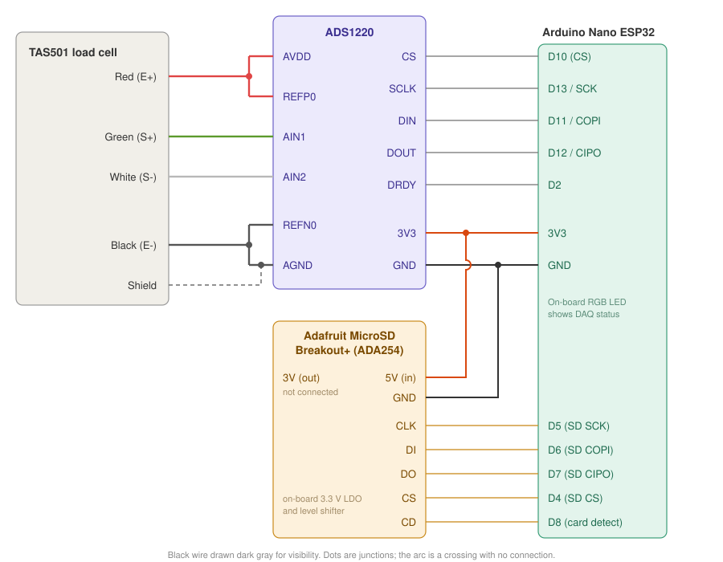

# Rocket motor DAQ (TAS501 / ADS1220 / Nano ESP32 / MicroSD)

A static-test thrust logger for model and high-power rocket motors. A SparkFun 200 kg S-beam load cell (TAS501) is read by a TI ADS1220 24-bit ADC at 1000 samples/s. An Arduino Nano ESP32 converts each sample to thrust and logs every burn to a MicroSD card on an Adafruit MicroSD Card Breakout Board+ (ADA254).

Recording starts on its own when thrust rises above **1 lbf** and stops when it falls back below **1 lbf**. Each burn is saved to its own CSV file, and a summary of peak thrust, average thrust, total impulse and motor class is printed and logged. No computer is needed at the test stand: the on-board RGB LED shows whether the DAQ is armed or recording.

This project is derived from [tas501-ads1220-scale](https://github.com/mwhite5948-web/tas501-ads1220-scale). It uses the same load cell and ADC wiring, so a calibration saved by the scale sketch carries over.

## Hardware

| Part | Notes |
|---|---|
| SparkFun Load Cell, 200 kg, S-Type (TAS501, SEN-14282) | 4-wire shielded cable, tension or compression, about 441 lbf / 1961 N capacity |
| ADS1220 breakout | 24-bit delta-sigma ADC with PGA up to x128 |
| Arduino Nano ESP32 (ABX00083) | ESP32-S3, 3.3 V logic, dual core |
| Adafruit MicroSD Card Breakout Board+ (ADA254) | On-board 3.3 V regulator and level shifter |
| MicroSD card | FAT32 formatted (cards of 32 GB or less are simplest) |

## Wiring

Full schematic and notes: [`docs/RocketDAQ_wiring.pdf`](docs/RocketDAQ_wiring.pdf)



**Load cell to ADS1220** (ratiometric: the excitation is also the ADC reference)

| Load cell wire | Function | ADS1220 pin(s) |
|---|---|---|
| Red | Excitation + | AVDD and REFP0 |
| Black | Excitation - | AGND and REFN0 |
| Green | Signal + | AIN1 |
| White | Signal - | AIN2 |
| Shield | Cable shield | AGND (ADC end only) |

**ADS1220 to Nano ESP32** (default SPI bus)

| ADS1220 | Nano ESP32 | ESP32-S3 GPIO |
|---|---|---|
| CS | D10 | GPIO21 |
| SCLK | D13 / SCK | GPIO48 |
| DIN | D11 / COPI | GPIO38 |
| DOUT | D12 / CIPO | GPIO47 |
| DRDY | D2 | GPIO5 |
| 3V3 / GND | 3V3 / GND | |

**Adafruit MicroSD Breakout+ (ADA254) to Nano ESP32** (second SPI bus)

| ADA254 | Nano ESP32 | ESP32-S3 GPIO | Notes |
|---|---|---|---|
| 5V | 3V3 | | The breakout's regulator accepts 3.3-6 V |
| GND | GND | | |
| CLK | D5 | GPIO8 | |
| DI | D6 | GPIO9 | data into the card |
| DO | D7 | GPIO10 | data out of the card |
| CS | D4 | GPIO7 | |
| CD | D8 | GPIO17 | card detect, internal pull-up enabled |
| 3V | not connected | | regulator output |

The SD card has its own SPI bus because a card can pause for tens to hundreds of milliseconds while it writes. On a shared bus, that pause would hold up the ADC reads during a burn. If you leave CD unconnected, the pull-up makes the firmware assume a card is always present, and everything else still works.

## Building and uploading

This is a [PlatformIO](https://platformio.org/) project.

```
pio run -e rocket_daq -t upload     # thrust logger
pio run -e diagnostic -t upload     # ADS1220 wiring check
pio device monitor                  # serial console, 115200 baud
```

In VS Code, open the folder with the PlatformIO extension and pick the environment from the status bar.

| Path | Contents |
|---|---|
| `src/daq/main.cpp` | Rocket motor DAQ firmware |
| `src/diag/main.cpp` | ADS1220 diagnostic, unchanged from the scale project |
| `docs/` | Wiring schematic (PDF, plus the SVG/HTML it is printed from) |

## Using it

### First-time calibration
1. Mount the load cell in the stand and connect USB. Open the serial monitor.
2. Send `t` with nothing loading the cell.
3. Load the cell **in the direction the motor will push** with a known mass, then send `c <kg>` (e.g. `c 20`) or `c <lb> lb` (e.g. `c 25 lb`).
4. Remove the mass. The reading should return to about 0. The calibration is saved in flash.

### On the test stand
1. Mount the motor, insert the SD card, then power up the DAQ. It **auto-tares at power-up**, so the motor's weight is zeroed out. Keep the stand still for 2 s while the LED is blue.
2. Wait for the LED to turn **green** (armed).
3. Fire the motor. The LED turns **red** while recording.
4. After burnout, the LED returns to green and the DAQ is armed for the next motor.

| LED | Meaning |
|---|---|
| Blue | Not calibrated, or taring / calibrating |
| Green | Armed: calibrated, SD card mounted, waiting for thrust |
| Red, solid | Recording a burn |
| Red, blinking | SD card missing or failed (burns are still summarised on Serial but not saved) |

### Serial commands (115200 baud, line ending "Newline")

| Command | Action |
|---|---|
| `t` | Tare (zero) |
| `c <kg>` / `c <lb> lb` | Calibrate with a known mass |
| `i` | Invert the thrust direction (e.g. calibrated in tension, testing in compression). Saved to flash |
| `r` | Toggle raw ADC counts in the live display |
| `d` | Dump registers, calibration, SD status and dropped-sample count |
| `l` | List files on the SD card |
| `x` | Erase saved calibration |
| `h` | Help |

Commands other than `d` and `h` are refused while a burn is being recorded.

## Trigger behaviour

| Setting (`src/daq/main.cpp`) | Default | Meaning |
|---|---|---|
| `TRIGGER_LBF` | 1.0 | Recording starts when thrust rises above this, and stops when it falls below it |
| `TRIGGER_AVG_N` | 5 | Samples (5 ms) averaged for the start/stop decision, so one noisy sample cannot trigger it |
| `STOP_HOLD_MS` | 100 | Thrust must stay below the threshold this long before the burn is considered over |
| `AUTO_TARE_ON_BOOT` | true | Tare automatically at power-up |

`STOP_HOLD_MS` stops a brief dip, such as a chuff or noise at tail-off, from splitting one burn into several files. A dip shorter than this stays in the file. When the burn really ends, the samples below 1 lbf during the hold are discarded. So each file runs from the first sample above 1 lbf to the last one, which matches the start/stop rule exactly. Set `STOP_HOLD_MS` to 1 to stop on the first low reading.

## Output files

**`/BURN_000.CSV`, `/BURN_001.CSV`, ...**: one file per burn, one row per sample (1000 rows/s).

```
time_s,thrust_N,thrust_lbf,raw_counts
0.0000,4.512,1.014,8342
0.0010,4.871,1.095,9006
...
```

`time_s` is measured from the first recorded sample, using each sample's timestamp from the ADC's data-ready interrupt.

**`/SUMMARY.CSV`**: one row per burn.

```
file,samples,duration_s,peak_N,peak_lbf,avg_N,impulse_Ns,class,saturated,dropped
BURN_000.CSV,1612,1.6110,38.41,8.63,21.07,33.940,E,0,0
```

Total impulse is integrated with the trapezoidal rule. The class is the standard letter (A = 1.26-2.5 N·s, doubling per letter). `saturated` counts samples that hit the ADC limits, and `dropped` counts samples lost to a full buffer. Both should be 0.

## How it works

- The ADS1220 runs continuously at 1000 SPS, gain 128, with the external (ratiometric) reference. The 50/60 Hz filter is off because it only works at 20 SPS.
- The DRDY falling edge fires an interrupt that timestamps the sample and wakes a top-priority FreeRTOS task on core 0. That task reads the 24-bit result and pushes it into an 8192-sample queue (about 8 s).
- The Arduino `loop()` on core 1 drains the queue. It runs the trigger, converts to N and lbf, and writes CSV through an 8 KB buffer, flushing to the card every 0.5 s. SD stalls are absorbed by the queue, and any loss is counted and reported.
- Tare and calibration average 2000 samples (2 s) from the same stream, so they never conflict with the sampling task.

## Diagnostic

`src/diag/main.cpp` (env `diagnostic`) uses the internal 2.048 V reference at gain 1, so it works even if the reference wiring is wrong. It prints AVDD, each signal input, the differential signal and a shorted-input reading. If the DAQ reports **ADC saturated**, run this first.

| Measurement | Expected |
|---|---|
| AVDD supply | about 3.0-3.3 V |
| AIN1 (green) | about half of AVDD |
| AIN2 (white) | about half of AVDD |
| AIN1 - AIN2 | a few mV, changes under load |
| Shorted inputs | about 0 mV |

## Safety

Load cell data is not a substitute for safe test-stand practice. Follow NAR/TRA and local rules: use a remote igniter, keep a safe distance, and make sure the stand is anchored for the motor's full rated thrust. The TAS501 is rated for 200 kg. For motors near or above about 400 lbf peak, use a larger cell.

## Notes

- At about 2 mV/V and 3.3 V excitation, full load is roughly 6.6 mV, well inside the ADS1220's ±25.8 mV range at gain 128. At 1000 SPS, the ADC noise works out to roughly 0.1 lbf RMS per sample. The 5-sample trigger average reduces that further, well below the 1 lbf threshold.
- If your ADS1220 breakout does not bring out REFP0/REFN0, set `REG2 = 0x00` in `src/daq/main.cpp` to use the internal 2.048 V reference (filter still off).
- D13 is also the built-in LED, so it flickers during ADS1220 SPI traffic. This is harmless.

## References

- [TAS501 datasheet](https://www.mouser.com/datasheet/2/813/TAS501-1223873.pdf)
- [ADS1220 datasheet](https://www.ti.com/lit/ds/symlink/ads1220.pdf)
- [Arduino Nano ESP32 cheat sheet](https://docs.arduino.cc/tutorials/nano-esp32/cheat-sheet)
- [Adafruit MicroSD Breakout Board+ (ADA254)](https://www.adafruit.com/product/254) and [tutorial](https://learn.adafruit.com/adafruit-micro-sd-breakout-board-card-tutorial)
